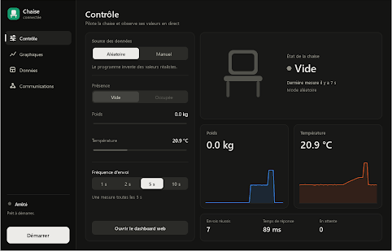
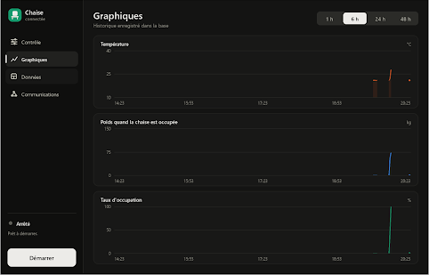
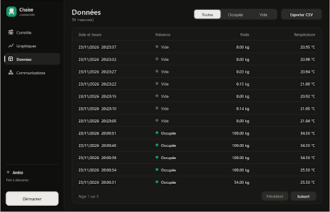
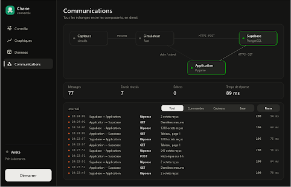

# Chaise connectée : simulateur IoT

> **Version actuelle : V1.** Le projet fonctionne, mais son installation demande encore quelques étapes techniques. La prochaine version le rendra facile à télécharger et à tester.

Ce projet simule une chaise connectée équipée de trois capteurs : **présence**, **poids** et **température**.

Il n'y a pas de vraie chaise. Un programme en Rust imite les capteurs, ajoute de petites erreurs de mesure comme sur du vrai matériel, puis envoie les données sur Internet vers une base de données. Une application permet ensuite de piloter la simulation et de voir les données en direct.

## Aperçu de l'application

### Contrôle



### Graphiques



### Données



### Communications



## Ce que fait le projet

- **Acquisition :** le programme lit les trois capteurs simulés à intervalle régulier.
- **Bruit réaliste :** les valeurs varient légèrement, car un vrai capteur n'est jamais parfaitement stable.
- **Pilotage :** on choisit des données aléatoires ou on règle soi-même la présence, le poids et la température.
- **Télémétrie :** chaque mesure est envoyée à la base de données au format JSON.
- **Coupure réseau :** si l'envoi échoue, les mesures sont gardées en mémoire et renvoyées au retour de la connexion.
- **Visualisation :** l'application affiche les valeurs, les courbes, le tableau des mesures et les échanges entre les programmes.

## Comment les données circulent

```text
Capteurs simulés  →  Programme Rust  →  Base Supabase  →  Application Pygame
                           ↑                         →  Dashboard web
                           └── commandes de l'application
```

1. Le programme Rust crée une mesure.
2. Il l'envoie à Supabase avec une requête HTTP `POST`.
3. Supabase enregistre la mesure dans la table `telemetrie`.
4. L'application et le dashboard relisent cette table pour afficher les données.

## Technologies utilisées

| Partie | Technologie | Rôle |
| --- | --- | --- |
| Capteurs et envoi | **Rust** | Simule les capteurs et envoie les mesures |
| Application | **Python + Pygame** | Démarre, arrête et pilote la simulation |
| Dashboard web | **Python + Streamlit** | Affiche des jauges et des graphiques dans le navigateur |
| Base de données | **Supabase + SQL** | Stocke les mesures dans PostgreSQL |

## Organisation des fichiers

```text
chaise/
├── src/               Programme Rust
│   ├── main.rs        Boucle principale : mesurer, envoyer, recommencer
│   ├── capteurs.rs    Les trois capteurs
│   ├── bruit.rs       Les petites erreurs de mesure
│   ├── chaise.rs      Le comportement de la chaise
│   ├── telemetrie.rs  Le format d'une mesure
│   ├── client_http.rs L'envoi vers Supabase
│   ├── pilotage.rs    Les commandes reçues depuis l'application
│   └── config.rs      La lecture du fichier .env
├── app/               Code de l'application Pygame
│   ├── fenetre.py     La fenêtre et le menu
│   ├── pages.py       Les pages Contrôle, Graphiques, Données, Communications
│   ├── composants.py  Les boutons, curseurs et graphiques
│   ├── services.py    Le lien avec le programme Rust et Supabase
│   └── theme.py       Les couleurs et les dimensions
├── interface.py       Point d'entrée de l'application
├── dashboard.py       Dashboard web Streamlit
├── schema.sql         Création de la table et des règles d'accès
├── lancer.sh          Lance l'application en une commande
├── requirements.txt   Bibliothèques Python
├── Cargo.toml         Bibliothèques Rust
└── .env.exemple       Modèle du fichier de configuration
```

## Installation et lancement

### 1. Ce qu'il faut installer

- [Rust](https://www.rust-lang.org/fr/tools/install)
- Python 3.10 ou plus récent
- Un compte gratuit sur [Supabase](https://supabase.com)
- Linux, ou Windows avec WSL

### 2. Créer la base de données

1. Crée un nouveau projet sur Supabase.
2. Ouvre **SQL Editor**, puis **New query**.
3. Colle tout le contenu de `schema.sql`.
4. Clique sur **Run**.

### 3. Configurer le fichier `.env`

Copie le modèle :

```bash
cp .env.exemple .env
```

Dans Supabase, clique sur **Connect** ou va dans **Settings > API Keys**, puis remplis `.env` :

```env
SUPABASE_URL=https://ton-projet.supabase.co
SUPABASE_ANON_KEY=sb_publishable_ta_cle
INTERVALLE_SECONDES=5
```

Utilise uniquement la clé publique `sb_publishable_...`. Ne mets jamais une clé `sb_secret_...`. Le fichier `.env` reste sur ton ordinateur et n'est pas envoyé sur GitHub.

### 4. Lancer le projet

```bash
./lancer.sh
```

Le script installe les bibliothèques Python si besoin, puis ouvre l'application. Clique ensuite sur **Démarrer**. Le premier démarrage peut prendre quelques minutes, car le programme Rust doit être compilé.

## Les pages de l'application

| Page | Utilité |
| --- | --- |
| **Contrôle** | Démarrer, choisir le mode et régler les valeurs |
| **Graphiques** | Voir l'historique sur 1 h, 6 h, 24 h ou 48 h |
| **Données** | Parcourir, filtrer et exporter les mesures en CSV |
| **Communications** | Suivre en direct les messages échangés et les codes HTTP |

## Tests

```bash
cargo test
```

Ces tests vérifient notamment le bruit des capteurs, le mode manuel, la lecture de la configuration et le format JSON.

## Limites du projet

- Les capteurs sont simulés : le projet ne lit pas encore de vrai matériel.
- La clé publique permet de lire et d'ajouter des mesures. C'est acceptable pour une démonstration, mais un vrai produit demanderait une authentification pour chaque chaise.

## Prochaine étape : V2

L'objectif de la V2 est de rendre le projet **téléchargeable et facile à lancer par tout le monde**, pour qu'un recruteur puisse le tester en quelques clics, sans installer Rust ni Python et sans créer de compte Supabase.

## Conception & Méthodologie

J'ai défini le besoin et le cahier des charges du projet, choisi les fonctionnalités attendues, orienté les évolutions de l'application et validé son fonctionnement en conditions d'utilisation.

Claude (Anthropic) a été utilisé comme outil d'AI pair-programming : il a proposé l'architecture détaillée et la modélisation des capteurs, écrit une grande partie du code et aidé au débogage. J'utilise ce projet pour relire, comprendre et savoir expliquer chacun de ces choix.
